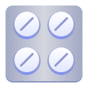
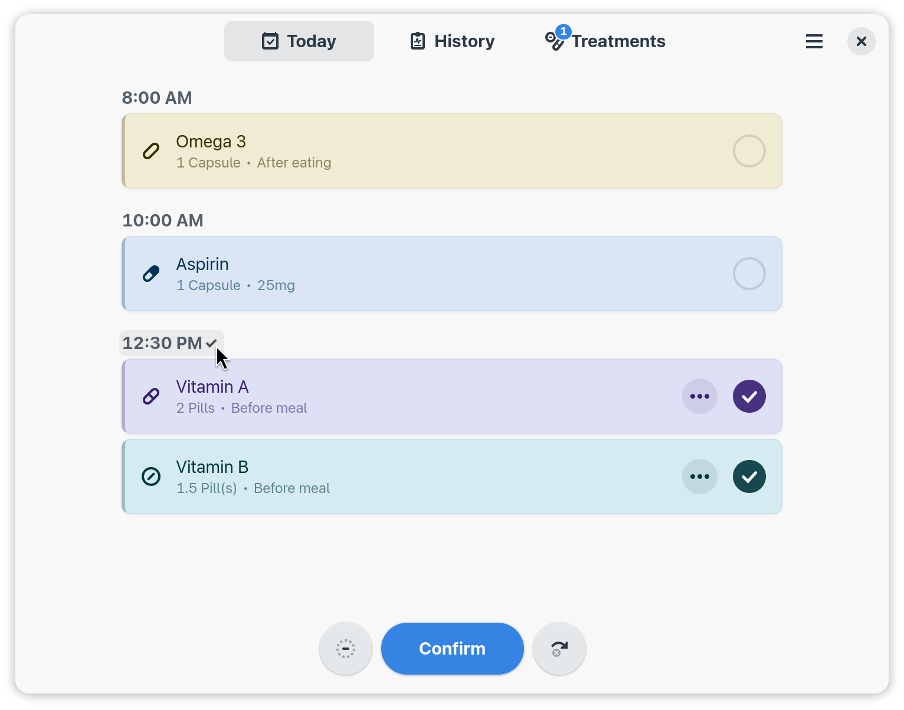
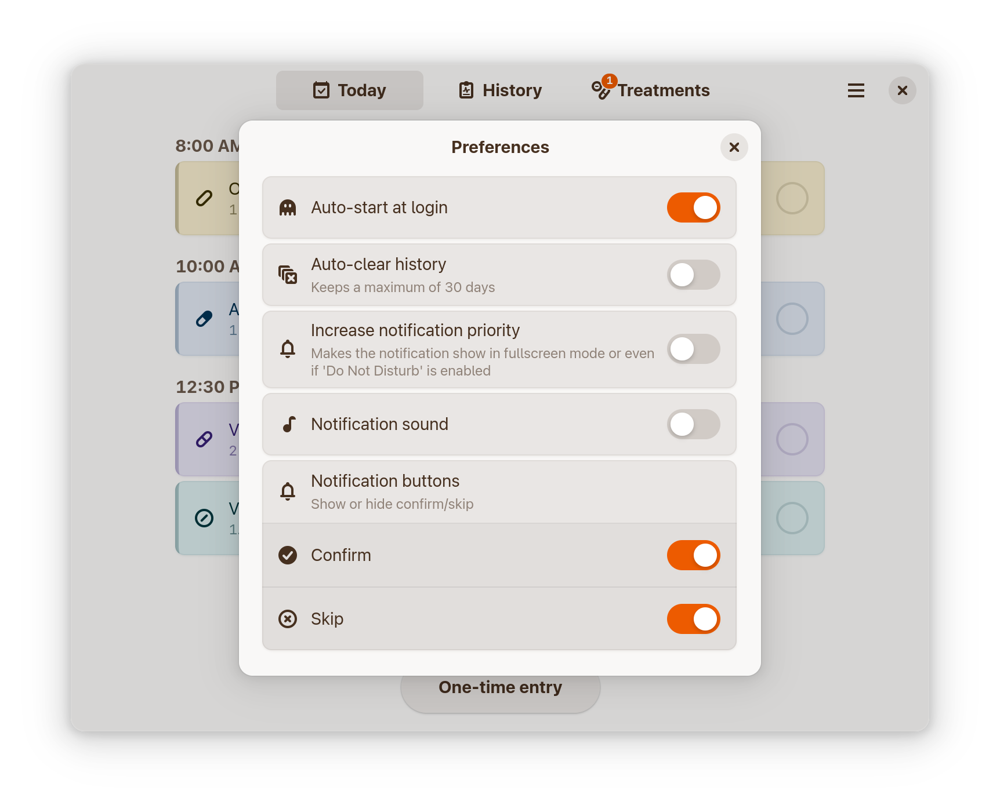
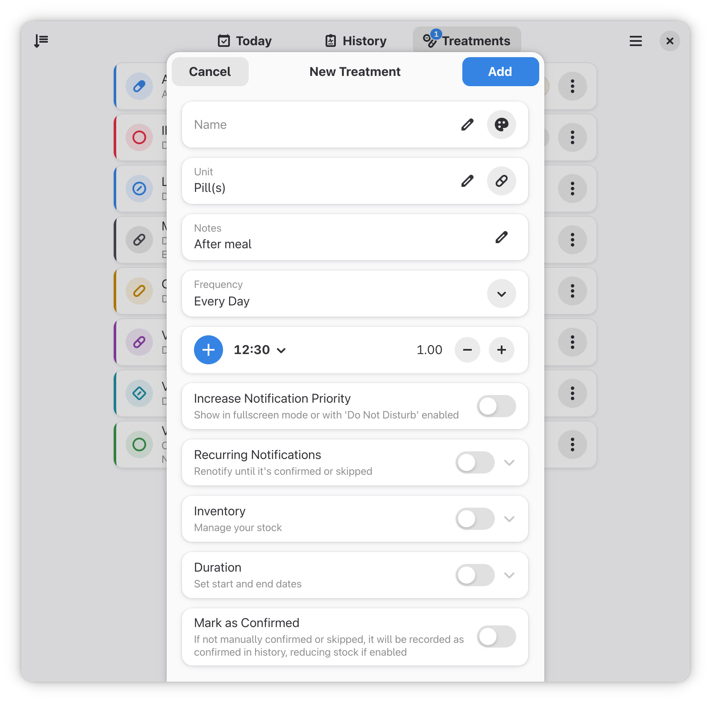
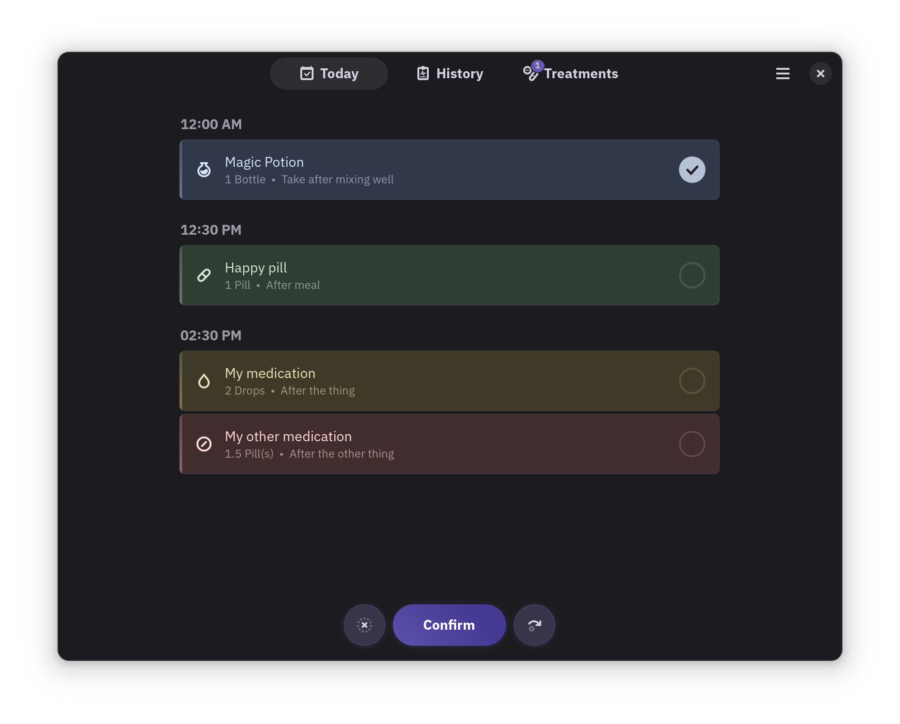

### Dosage
Keep track of your treatments

<br>

</a> <a href='https://flathub.org/apps/io.github.diegopvlk.Dosage'></a> <a href="https://snapcraft.io/dosage-tracker">

</a>

### Features

- **Notifications** — Get reminders at the right time
- **History** — See which medications you took, skipped or missed
- **Dosage management** — Multiple doses with different times
- **Frequency modes** — Every day, selected days, cycle or just when necessary
- **Color and icon** — Give a shape for your treatment
- **Inventory tracking** — Monitor your stock and get reminded when it's low
- **Duration** — Define the start and end dates

<p align="center"></p>

<div>
  <details>
    <summary>Other screenshots</summary><br>
      <p align="center"></p>
      <p align="center"></p>
      <p align="center"></p>
  </details>
</div>

### Donate

If you want to help with a donation (thank you!), you can use:

- [PayPal](https://www.paypal.com/donate?hosted_button_id=DVL7H35GA66X6)
- [Ko-fi](https://ko-fi.com/diegopvlk)
- Pix: diego.pvlk@gmail.com

### Translations

You can help translate using [Weblate](https://hosted.weblate.org/projects/dosage/dosage/)

<a href="https://hosted.weblate.org/engage/dosage/">
  
</a>

### Code of Conduct

This project follows the [GNOME Code of Conduct](https://conduct.gnome.org)

### Build from source

Clone the repo in GNOME Builder and press run

### macOS (source build)

The macOS port uses GTK's native macOS backend. Install [Homebrew](https://brew.sh), then:

```sh
brew install gjs gtk4 libadwaita meson ninja blueprint-compiler terminal-notifier
./macos/build.sh
open build/macos/Dosage.app
```

You can copy `build/macos/Dosage.app` to `~/Applications`. This is a local app bundle:
its GTK/GJS runtime remains in Homebrew, so it is not a standalone distributable.
Rebuild after moving the source checkout; the generated app itself can be moved.

- Treatments, history, and settings are stored under `~/Library/Application Support/Dosage/`.
- Enable notification permission for **terminal-notifier** in System Settings → Notifications.
  Reminders use its native notification backend; hover a reminder to reveal Confirm/Skip.
  Notification actions remain available for up to 24 hours while Dosage is running.
  System settings control notification appearance, sounds, and Focus; the Linux priority
  switch cannot override them. Clicking a reminder opens Dosage.
- Keep Dosage running for reminders. Closing its window keeps it running; use **⌘Q** to quit.
  It cannot wake a sleeping Mac. After waking, it detects the clock gap and recalculates reminders.
- The automatic startup preference creates/removes
  `~/Library/LaunchAgents/io.github.diegopvlk.Dosage.plist` for the next login.
  Enable it after moving the app to its final location. If you move it again, toggle
  automatic startup off and on to update the path.
- Opening the app again brings the existing window forward, including when it started hidden.

Build and integration checks (macOS):

```sh
meson test -C build/macos-build --print-errorlogs
./tests/run-macos.sh
./tests/run-app-smoke.sh
```

The integration checks use temporary data, a fake notification helper, and a temporary
login-agent location. The GUI smoke check opens test windows and verifies treatment and
settings persistence across a restart without recording any doses.
